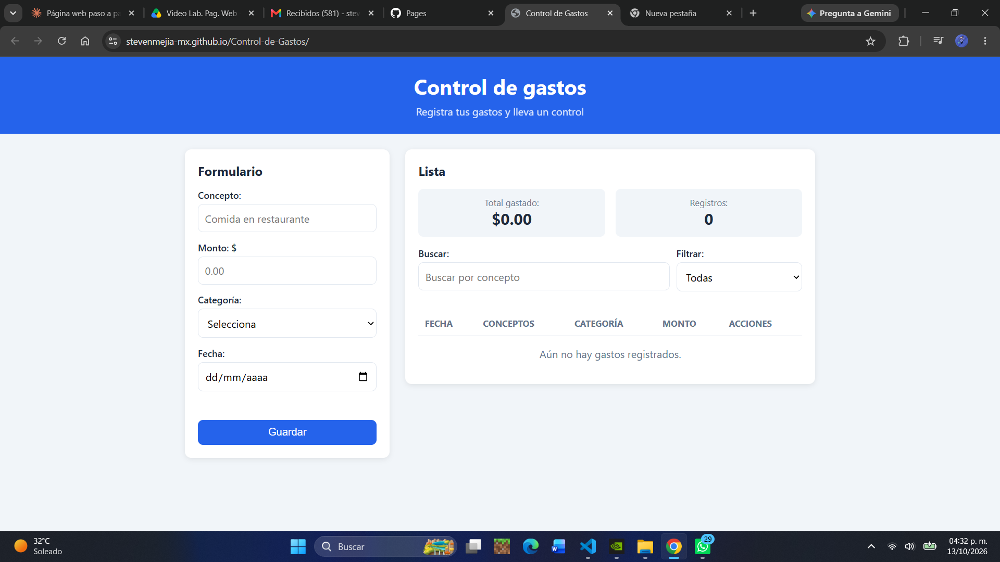
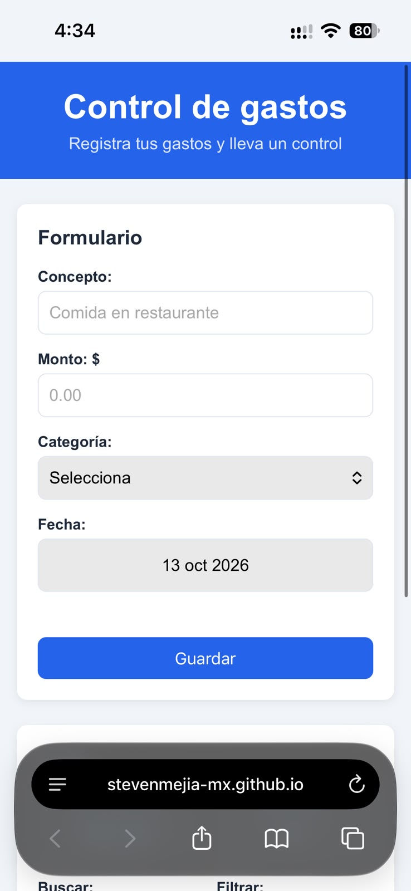

# Control de Gastos

Aplicación web del lado del cliente para registrar, consultar, editar y eliminar gastos personales. Funciona completamente en el navegador, sin servidor: los datos se guardan con `localStorage` y se conservan entre sesiones.

Proyecto desarrollado para la materia de **Programación Web** — FIME, UANL.

---

## Funcionalidades

- **Agregar gastos** con concepto, monto, categoría y fecha.
- **Ver la lista de gastos** en una tabla ordenada de la fecha más reciente a la más antigua.
- **Editar gastos**: los datos se cargan en el formulario y se actualizan sin recargar la página.
- **Eliminar gastos**, con confirmación antes de borrar.
- **Validación de datos** con mensajes claros y el campo con error resaltado en rojo.
- **Persistencia con `localStorage`**: la información se conserva al cerrar o recargar el navegador.
- **Búsqueda por concepto** en tiempo real.
- **Filtro por categoría**.
- **Cálculo automático** del total gastado y del número de registros (según los gastos visibles).
- **Diseño responsivo**: se adapta a pantallas de computadora y de celular.

---

## Tecnologías

| Tecnología | Uso |
|---|---|
| **HTML5** | Estructura semántica (`header`, `main`, `section`), formulario y tabla |
| **CSS3** | Variables CSS, Flexbox, Grid y media queries para el diseño responsivo |
| **JavaScript ES6+** | Lógica de la aplicación, manipulación del DOM, eventos y `localStorage` |
| **Git / GitHub** | Control de versiones y repositorio del proyecto |
| **Chrome DevTools** | Depuración y pruebas de diseño responsivo |

---

## Estructura del proyecto

```
control-gastos/
├── index.html        → Estructura de la página
├── css/
│   └── styles.css    → Estilos y diseño responsivo
├── js/
│   └── script.js     → Lógica de la aplicación
└── README.md         → Documentación
```

---

## Cómo ejecutar el proyecto

No requiere instalación ni servidor.

1. Link de Pagina Web: https://stevenmejia-mx.github.io/Control-de-Gastos/

---

## Cómo usar la aplicación

1. **Registrar un gasto:** llena el concepto, el monto, la categoría y la fecha, y presiona **Guardar**.
2. **Editar un gasto:** presiona ✏️ en la fila del gasto, modifica los datos y presiona **Actualizar**. Para salir sin cambios, presiona **Cancelar**.
3. **Eliminar un gasto:** presiona 🗑️ y confirma.
4. **Buscar:** escribe en el campo *Buscar* para ver solo los gastos cuyo concepto coincida.
5. **Filtrar:** elige una categoría en *Filtrar* para ver solo los gastos de esa categoría.

El total y el contador se actualizan automáticamente con cada cambio, búsqueda o filtro.

---

## Modelo de datos

Cada gasto se representa como un **objeto** de JavaScript, y todos los gastos se guardan en un **arreglo** llamado `gastos`:

```javascript
{
    id: 1728691200000,
    concepto: "Uber a la escuela",
    monto: 85.5,
    categoria: "transporte",
    fecha: "2026-10-11"
}
```

| Propiedad | Tipo | Descripción |
|---|---|---|
| `id` | `number` | Identificador único, generado con `Date.now()` |
| `concepto` | `string` | Descripción del gasto (3 a 50 caracteres) |
| `monto` | `number` | Cantidad gastada, redondeada a 2 decimales |
| `categoria` | `string` | `comida`, `transporte`, `escuela`, `servicios` u `otros` |
| `fecha` | `string` | Fecha en formato `AAAA-MM-DD` |

El arreglo se guarda en `localStorage` con la clave `control-gastos` en formato JSON.

---

## Validaciones

Antes de guardar un gasto, la aplicación verifica que:

- El **concepto** no esté vacío y tenga entre 3 y 50 caracteres.
- El **monto** sea un número mayor que 0 y no mayor a $1,000,000.
- Se haya **seleccionado una categoría** válida.
- La **fecha** no esté vacía y no sea una fecha futura.

Si algo es inválido, se muestra un mensaje de error y el campo se marca en rojo hasta que el usuario lo corrige.

---

## ⚙️ Funciones principales

| Función | Qué hace |
|---|---|
| `validarFormulario()` | Revisa los datos del formulario y regresa el gasto o `null` si hay errores |
| `agregarGasto()` | Crea un gasto nuevo y lo agrega al arreglo |
| `empezarEdicion()` | Carga un gasto en el formulario para editarlo |
| `actualizarGasto()` | Reemplaza los datos de un gasto existente |
| `eliminarGasto()` | Elimina un gasto después de confirmar |
| `obtenerGastosVisibles()` | Aplica búsqueda, filtro y orden a la lista |
| `mostrarGastos()` | Dibuja la tabla, el total y el contador en la página |
| `guardarEnStorage()` / `cargarDeStorage()` | Guardan y recuperan los datos de `localStorage` |

### Sintaxis moderna utilizada

- `let` y `const` para declarar variables.
- **Template literals** para generar el HTML de cada fila.
- **Arrow functions** en funciones auxiliares y en eventos.
- **Métodos de arreglos:** `filter`, `map`, `find`, `findIndex`, `reduce`, `sort`, `includes` y `forEach`.
- **Operador spread** (`...`) para crear y actualizar objetos.
- **Desestructuración** de arreglos para formatear la fecha.
- **Delegación de eventos** para los botones de editar y eliminar de la tabla.

---

## 🎯 Requisitos de la práctica

| # | Requisito | Cumplimiento |
|---|---|---|
| 1 | Aplicación tipo gestor (control de gastos) | ✅ |
| 2 | Modelar los datos con objetos y arreglos | ✅ Cada gasto es un objeto dentro del arreglo `gastos` |
| 3 | Agregar, visualizar, editar y eliminar registros | ✅ |
| 4 | Manipular el DOM sin recargar la página | ✅ `preventDefault()` y `mostrarGastos()` |
| 5 | Eventos, funciones y sintaxis moderna | ✅ `addEventListener`, arrow functions, template literals, métodos de arreglos |
| 6 | Validar datos y mostrar mensajes claros | ✅ `validarFormulario()` |
| 7 | Guardar y recuperar con `localStorage` | ✅ `guardarEnStorage()` / `cargarDeStorage()` |
| 8 | Función adicional | ✅ Búsqueda, filtro, ordenamiento, contador y total automático |

---

## 📸 Capturas de pantalla




---

## 🎥 Demostración

Video de demostración: [ver video](https://drive.google.com/file/d/1D2BF8siWTCeBdU9BzubXHHCH5HksJFoT/view?usp=sharing)

---
